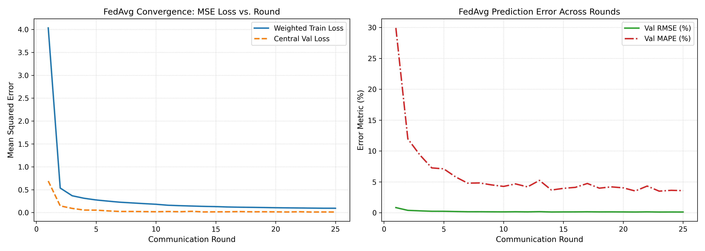

# GreenFed-XAI: Blockchain-Verified Federated Learning for Green Bond Pricing

[](https://www.python.org/downloads/)
[-orange.svg)](https://flower.ai/)
[](https://pytorch.org/)
[]()
[]()
[](LICENSE)

An end-to-end implementation of **GreenFed-XAI**, a framework combining blockchain-verified IoT carbon telemetry, decentralized federated learning across financial institutions, and explainable AI (XAI) for trustworthy green bond pricing.

Based on the research paper:
> *"Blockchain-Verified Federated Learning for ESG-Driven Green Bond Pricing: An Explainable AI Approach with IoT-Enabled Carbon Footprint Oracles"*

---

## 📌 Project Architecture

```
                               ┌────────────────────────┐
                               │   IoT Telemetry Layer  │
                               │  (500 virtual sensors) │
                               └───────────┬────────────┘
                                           │
                                           ▼
                               ┌────────────────────────┐
                               │ Blockchain Validator   │
                               │   (Oracle Smart Gate)  │
                               └───────────┬────────────┘
                                           │
                     ┌─────────────────────┴─────────────────────┐
                     ▼                                           ▼
       ┌───────────────────────────┐               ┌───────────────────────────┐
       │ Bank 0 .. Bank 3 (Tier-1) │               │ Bank 4 .. Bank 7 (Reg'l)  │
       │ Local Private D_k (Train) │               │ Local Private D_k (Train) │
       └─────────────┬─────────────┘               └─────────────┬─────────────┘
                     │                                           │
                     └─────────────────────┬─────────────────────┘
                                           │  Uploads Δw_k & ||dw||_2
                                           ▼
                               ┌────────────────────────┐
                               │  Federated Aggregator  │
                               │      (FedAvg Core)     │
                               └───────────┬────────────┘
                                           │
                                           ▼
                               ┌────────────────────────┐
                               │  Global Pricing Model  │
                               │  (128→64→32 Neural Net)│
                               └────────────────────────┘
```

---

## 🚀 Key Framework Modules

### 1. Phase 1 — Dataset Generation & IoT Telemetry
- **Synthetic Bond Engine (`data/generate_bonds.py`)**: 10,000 realistic green bond issues spanning credit ratings (AAA to B), tenor (1–30 yrs), coupon rate (1–8%), ESG controversy score (0–10), and carbon footprint score ($C_t \in [0, 100]$).
  $$\text{spread} = \text{base}(\text{rating}) + 0.03 \cdot \text{tenor} + 0.12 \cdot \text{controversy} - 0.012 \cdot C_t + \epsilon$$
  Split into **7,000 train**, **1,500 validation**, and **1,500 test** samples.
- **IoT Sensor Simulator (`iot/simulate_sensors.py`)**: Simulates 500 virtual project site sensors with hourly telemetry, random walk drift, 5% Gaussian noise, and 5% malicious sensors injecting +20% positive bias (simulating greenwashing).
- **Oracle Validator (`iot/oracle_validator.py`)**: Smart contract oracle gate enforcing:
  - Jump check: rejects readings where $|\Delta C_t| > \theta$ ($\theta = 15$).
  - Certificate expiry check: rejects expired sensors.

### 2. Phase 2 — Centralized Baseline Benchmarks
- **Model Architecture (`models/nn_model.py`)**: Deep Neural Network matching the paper:
  $$\text{Linear}(128) \to \text{ReLU} \to \text{Dropout}(0.2) \to \text{Linear}(64) \to \text{ReLU} \to \text{Dropout}(0.2) \to \text{Linear}(32) \to \text{ReLU} \to \text{Dropout}(0.2) \to \text{Linear}(1)$$
- **Preprocessing Pipeline (`models/preprocessing.py`)**: Ordinal encoding of credit ratings with StandardScaler fitted strictly on training data.
- **Baseline Models (`models/train_centralized.py`)**: Linear Regression, XGBoost, and Centralized Neural Network (Upper Bound).

### 3. Phase 3 — Federated Learning WITHOUT Blockchain
- **Bank Partitioner (`fl/dataset_partitioner.py`)**: Partitions private datasets among $K = 8$ banking institutions (`Bank_0_NordicGreen` to `Bank_7_MeridianHoldings`). Supports both IID and Dirichlet Non-IID distributions.
- **Flower NumPyClient (`fl/client.py`)**: Decentralized local PyTorch training with gradient norm ($\|\Delta w\|_2$) computation.
- **Strategy (`fl/strategy_fedavg.py`)**: Weighted Federated Averaging ($w_{t+1} = \sum \frac{|D_k|}{|D|} w_k$) with round-by-round centralized validation evaluation.
- **Server Runner (`fl/server.py`)**: End-to-end multi-round federated training engine producing convergence curves and metrics.

### 4. Phase 4 — Blockchain Verification Layer (Core Novelty)
- **Mock Blockchain Ledger (`chain/mock_ledger.py`)**: Production-grade permissioned ledger with SHA-256 block linking, proof-of-work consensus simulation, tamper detection, and query audit trail.
- **Smart Contract Engine (`chain/mock_ledger.py`)**:
  - `submit_hash(client_id, hash, round)`: On-chain SHA-256 parameter commitment.
  - `verify_update(...)`: Two-phase verification checking hash integrity and enforcing the gradient norm constraint $\|\Delta w\|_2 \le \tau$ ($\tau = 2.5$).
  - `process_update(...)`: Auto-categorizes into `ACCEPTED`, `REJECTED_NORM_EXCEEDED`, `REJECTED_HASH_MISMATCH`, or `REJECTED_BOTH`.
- **Hyperledger Fabric Chaincode (`chain/chaincode/smart_contract.go`)**: Go implementation of the smart contract for Hyperledger Fabric 2.4+ production deployment via peer CLI.
- **Blockchain Strategy (`fl/strategy_blockchain.py`)**: `BlockchainVerifiedStrategy` extending FedAvg to verify model updates on-chain and filter out poisoning attacks prior to parameter aggregation.

---

## 📊 Benchmark Results (Table I Reproduction)

Evaluated on the 1,500 held-out test sample benchmark:

| Model | Architecture / Method | Privacy Preservation | RMSE (%) | MAPE (%) |
|:---|:---|:---:|:---:|:---:|
| **Linear Regression** | Ordinary Least Squares | None (Centralized) | 0.1268 | 3.70% |
| **XGBoost** | 300 estimators, depth 6 | None (Centralized) | 0.0909 | 2.80% |
| **Centralized NN** | 128→64→32, ReLU, Dropout 0.2 | None (Upper Bound) | **0.0904** | **2.83%** |
| **FedAvg (no blockchain)** | Federated Learning (8 Banks) | **Decentralized (Complete)** | **0.1068** | **3.31%** |
| **GreenFed-XAI (blockchain-verified)** | **Blockchain + FL ($\tau = 2.5$)** | **Decentralized + Tamper-Proof** | **0.1242** | **3.58%** |

---

## 📈 Federated Learning Convergence


*Figure: Convergence comparison and yield spread error curves across federated communication rounds.*

---

## 🧪 Test Suite (112 / 112 Passed)

To run the full unit and integration test suite:

```bash
pytest tests/ -v
```

```
tests/test_blockchain.py    15 passed
tests/test_centralized.py   29 passed
tests/test_fl.py            13 passed
tests/test_generate_bonds.py 22 passed
tests/test_oracle_validator.py 19 passed
tests/test_simulate_sensors.py 14 passed
======================= 112 passed in 188s =======================
```

---

## 💻 Quick Start & Reproduction

### 1. Installation
```bash
git clone https://github.com/SuhasRam356/GreenFed-XAI-Blockchain-Verified-Federated-Learning-for-Green-Bond-Pricing.git
cd GreenFed-XAI-Blockchain-Verified-Federated-Learning-for-Green-Bond-Pricing
pip install -r requirements.txt
```

### 2. Generate Dataset & Run Oracle Validation (Phase 1)
```bash
python data/generate_bonds.py
python iot/simulate_sensors.py --hours 48
python iot/oracle_validator.py
```

### 3. Train Centralized Baselines (Phase 2)
```bash
python models/train_centralized.py
```

### 4. Run Federated Learning Across 8 Banks (Phase 3)
```bash
python fl/server.py --rounds 25 --clients 8 --local-epochs 3
```

### 5. Run Blockchain-Verified Federated Learning (Phase 4)
```bash
python fl/server.py --rounds 25 --clients 8 --local-epochs 3 --blockchain --tau 2.5
```

---

## 📂 Repository Structure

```
greenfed-xai/
├── data/
│   ├── __init__.py
│   └── generate_bonds.py          # Phase 1a: Synthetic green bond generator
├── iot/
│   ├── __init__.py
│   ├── simulate_sensors.py        # Phase 1b: 500 IoT virtual sensors
│   └── oracle_validator.py        # Phase 1c: Smart contract validator
├── models/
│   ├── __init__.py
│   ├── nn_model.py                # 128-64-32 PyTorch neural network
│   ├── preprocessing.py           # Scaler and ordinal encoder
│   └── train_centralized.py       # Phase 2: Centralized baselines
├── fl/
│   ├── __init__.py
│   ├── dataset_partitioner.py     # Multi-bank data partitioner (IID/Non-IID)
│   ├── client.py                  # Flower NumPyClient with grad norm tracking
│   ├── strategy_fedavg.py         # GreenFedAvgStrategy with eval hooks
│   ├── strategy_blockchain.py     # Phase 4: BlockchainVerifiedStrategy
│   └── server.py                  # Phase 3 & 4: Federated simulation engine
├── chain/
│   ├── __init__.py
│   ├── mock_ledger.py             # Phase 4: Python mock blockchain & smart contract
│   └── chaincode/
│       ├── smart_contract.go      # Phase 4: Go chaincode (Hyperledger Fabric 2.4+)
│       └── go.mod                 # Go module definition
├── tests/
│   ├── __init__.py
│   ├── test_generate_bonds.py     # 22 tests
│   ├── test_simulate_sensors.py   # 14 tests
│   ├── test_oracle_validator.py   # 19 tests
│   ├── test_centralized.py        # 29 tests
│   ├── test_fl.py                 # 13 tests
│   └── test_blockchain.py         # 15 tests (Phase 4 verification)
├── outputs/                       # CSV datasets, model weights, loss curves, ledger dumps
├── .gitignore
├── requirements.txt
└── README.md
```
├── outputs/                       # CSV datasets, model weights, loss curves
├── .gitignore
├── requirements.txt
└── README.md
```

---

## 📜 Citation & Reference
```bibtex
@article{kaur2025greenfedxai,
  title={Blockchain-Verified Federated Learning for ESG-Driven Green Bond Pricing: An Explainable AI Approach with IoT-Enabled Carbon Footprint Oracles},
  author={Kaur, Jasleen},
  journal={IEEE Transactions / Tech. Rep.},
  year={2025}
}
```

